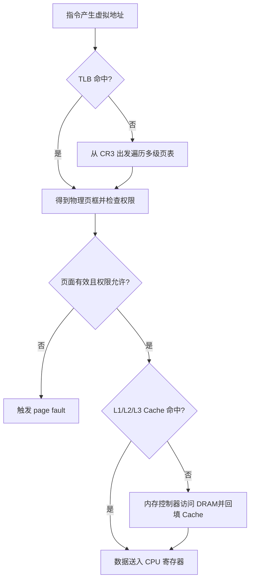
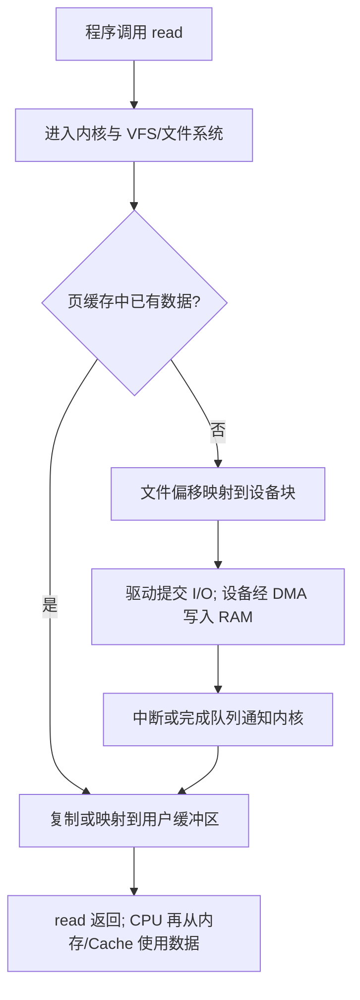

## task 1 
### task 1.1识破奸商
#### task 1.1.1
  | 部件 | 是什么 | 提供什么 | 功能 |
| --- | --- | --- | --- |
| **CPU** | 中央处理器,几十亿晶体管 | 通用运算 + 控制 | **串行**执行程序、调度硬件、缓存加速("总指挥") |
| **GPU** | 成千上万简单核心 | **并行**算力 + 图形管线 | 渲染画面、AI 计算、视频转码("同时做一万件事") |
| **主板** | 电路板 + 芯片组 + 供电 | 插槽、总线、VRM 供电、BIOS | 让所有部件互联,**决定平台上限**("地基,自己不算东西") |
#### task 1.1.2

- 手机宣传的 `512 GB` 通常是持久化存储，如 UFS/NAND Flash，断电后数据保留。
- 电脑的 `16 GB 内存` 通常指 DRAM 主存，断电后数据消失，CPU 正在运行的程序主要放在这里。

- **主存 / RAM**：CPU 运行程序时的工作区，速度快、易失。
- **存储 / 外存**：SSD、HDD、手机闪存等，容量大、非易失。
- **内存**：在计算机系统课程中通常指 RAM；手机营销中却常把存储容量也叫“内存”。
 #### task 1.1.3 
  电源不能只看额定瓦数，还应看：

- 额定功率是否留有余量，能否应对 CPU/GPU 瞬时功耗。
- 过压、过流、过温、短路等保护。
- 做工、保修和可靠评测。
- 转换效率；但效率认证不等于全部质量。
#### task 1.1.4
不一定


cpu与Gpu的性能看什么


**Cpu** :
- 单核性能，单核的主频
- 核心，线程数量
- 缓存l1,l2,l3
- 架构 功耗


**GPU** :
- 流处理器cuda核心，浮点算力
- 显存带宽
- 显存容量
  


#### task 1.1.5

1. “大牌主板”只有品牌，没有芯片组、插槽、供电、接口和型号。
2. “比 i5 多 i2 的 i7 级 CPU”没有技术意义；`i5/i7` 是产品分级，不是可做算术的性能单位。
3. “16G 高端内存”没说代际、频率、时序、通道、容量组合和兼容性。
4. “GPU 比上一代高出一半”没说上一代哪个型号、在哪个任务、何种功耗和测试条件。
5. “手机 512G 内存”大概率把存储容量包装成运行内存。
6. “1.25T 超大硬盘”只给容量，没说 HDD/SSD、接口、速度、耐久和健康状态。
7. 完全没交代电源、散热、机箱和各部件兼容性。

### task 1.2 你问我答
#### task 1.2.1
| 介质 | 常见位置 | 特点 | 为什么用在这里 |
|---|---|---|---|
| SRAM | CPU 的 L1/L2/L3 Cache | 很快、无需刷新、面积大、成本高、易失 | Cache 容量不必像主存那么大，但必须低延迟 |
| DRAM | 内存条、主存 | 比 SRAM 慢且需刷新，但密度高、单位成本低、易失 | 适合提供 GB 级工作内存 |
| NAND Flash | SSD、UFS、eMMC、U 盘 | 非易失、容量大、按页读写/按块擦除、写入寿命有限 | 适合长期保存系统、程序和数据 |
| HDD | 机械硬盘 | 非易失、单位容量便宜、容量大，但机械寻道延迟高 | 适合大容量低成本存储、归档 |
#### task 1.2.2
- **寄存器**位于 CPU 核心内部，由指令直接使用，数量很少、速度最快。通用寄存器通常由触发器/锁存结构实现，不应简单说成“就是 SRAM”。
- **Cache**通常在 CPU 芯片内部，L1 最小最快，随后是 L2、L3；主要由 SRAM 构成。
- **ROM**泛指断电保留且通常以读取为主的存储。现代 PC 固件常放在主板上的 SPI Flash 中；嵌入式 SoC 也可能有片上 Boot ROM。
可以把层次理解为：越靠近 CPU 越快、越小、越贵。

```text
寄存器 → L1 → L2 → L3 → DRAM → SSD/HDD
快/小/贵                           慢/大/便宜
```
#### task 1.2.3
典型 DRAM 单元是 **1 个晶体管 + 1 个电容（1T1C）**：

- 电容有电/无电近似表示 1/0。
- 电荷会随时间泄漏，所以控制器必须周期性刷新。
- 读取一行时，字线打开晶体管，微小电荷变化由感应放大器检测并放大。
- 读取会扰动原电荷，因此还要恢复写回。
#### task 1.2.4
- **时间局部性**：刚使用的数据很可能很快再次使用。
- **空间局部性**：访问某地址后，很可能继续访问附近地址。

Cache 不只取一个字节，而通常按一个 cache line 搬运一整块相邻数据，因此顺序访问往往比跨大步长访问更友好。
#### task 1.2.5
矩阵的优化 ：
  

这是欧美打法 :
```c
for (int i = 0; i < n; ++i)
    for (int j = 0; j < n; ++j)
        for (int k = 0; k < n; ++k)
            C[i][j] += A[i][k] * B[k][j];
```
虽然说很容易想到，但是这里 `B[k][j]` 随 `k` 变化，相当于按列跨行访问，步长约为一整行，空间局部性差。


这种方法确实很好想，但还是太吃时间了。

有没有更简洁快速的方法 ？


有的兄弟 有的 ：


把循环改成 `i-k-j`：

```c
for (int i = 0; i < n; ++i) {
    for (int k = 0; k < n; ++k) {
        int a = A[i][k];            
        for (int j = 0; j < n; ++j) {
            C[i][j] += a * B[k][j];      
        }
    }
}
```

这里同时利用：

- `A[i][k]` 在内层循环反复使用：时间局部性。
- `B[k][j]`、`C[i][j]` 顺序访问：空间局部性。
## task 2
### task 2.1 揭开虚拟的面纱
#### task 2.1.1
- **虚拟地址 VA**：程序和 CPU 指令通常使用的地址，属于某个进程的虚拟地址空间。
- **物理地址 PA**：最终访问 RAM 中物理位置所使用的系统地址。
好处:
1. **隔离和保护**：一个进程不能随意读写另一个进程或内核的内存。
2. **简化编程与装载**：每个进程看到连续、独立的地址空间，程序不必知道真实 RAM 放在哪。
3. **按需分配**：只有真正访问到的页面才需要分配物理页框。
#### task 2.1.2

  ##### task 2.1.2.1
- 每个进程拥有独立 私有的虚拟空间地址，进程之间互不干扰，一个进程不能随意访问另一个进程的虚拟地址
- 通过页表映射后才能找到物理内存
- 32位的情况下 虚拟地址空间一共2^32 == 4GB
  ##### task 2.1.2.2
- 虚拟地址空间被切分为固定大小的页（虚拟页）32位x86默认虚拟页大小为2^12 == 4KB 对应地址后12位
  ##### task 2.1.2.3
- 用户空间常见区域：

- 代码段：机器指令，通常可读、可执行。
- 只读数据：字符串常量等。
- 数据段：已初始化全局/静态变量。
- BSS：未显式初始化或零初始化全局/静态变量。
- 堆：动态分配区域，通常向高地址增长。
- `mmap` 区：共享库、文件映射、匿名映射等。
- 栈：函数调用、局部数据等，典型 x86/Linux 上向低地址增长。
  ##### taks 2.1.2.4
- **页 page**：虚拟地址空间被切分的固定大小单位。对进程地址空间进行分页管理
- **页框 page frame**：物理内存被切分的同样大小单位。座位内存分配的基本工具
- 页表把“虚拟页号”映射到“物理页框号”。
**共同点**：
- 大小相等
- 都是内存管理的基本单位
- 一一对应

  ### task 2.2认识页表管理
  #### task 2.2.1
  ##### task 2.2.1.1
- 页是虚拟空间中的数据单位。
- 页表是保存“虚拟页 → 物理页框”映射及权限位的数据结构。
- 页表自身也占内存，通常存放在物理内存的若干页框中。
  ##### task 2.2.1.2
- **MMU** 是处理器中的地址翻译与权限检查硬件。它把 VA 翻译成 PA，并检查当前访问是否允许。
- **TLB** 是页表翻译结果的高速缓存。TLB 命中时可跳过慢得多的内存页表遍历。
  ##### task 2.2.1.3
- 不管是单级页表还是多级页表（页目录等）都放在物理内存中（DRAM）
- CR3 是用来记录“物理基地址”的寄存器，位于uncore区
  ##### task 2.2.1.4
  32 位、4 KiB 页时：

```text
虚拟页数 = 2^32 / 2^12 = 2^20 = 1,048,576
```

若每个单级 PTE 是 4 字节，每个进程需要约：

```text
1,048,576 × 4 bytes = 4 MiB
```

即使进程只用了少量地址，也要预留整张表。

二级页表把它拆成：

- 1024 个页目录项 PDE。
- 每个有效 PDE 指向一张含 1024 个 PTE 的页表。
- 没使用的大片地址区间不用分配第二级页表。

优势 ：

-  单级页表：哪怕进程只用了很少一部分虚拟地址，依然需要为整个 4 GB 虚拟空间预先准备完整的一张巨大页表，占用大量内存。

- 二级页表：进程没有用到的虚拟地址区间，对应的二级页表根本不用创建、不用分配物理内存。
只在真正用到某一段虚拟地址的时候，才按需分配对应的二级页表。

- 很多进程只使用很小一部分虚拟地址，此时大量二级页表可以不用存在，极大节约物理内存。
##### task 2.2.1.5

```text
31              22 21              12 11               0
+-----------------+------------------+------------------+
| 页目录项索引 10位 | 页表索引 10位    | 页内偏移 12位   |
+-----------------+------------------+------------------+
```
以 `0x00001A2B` 为例：

```text
页目录索引 = 0
页表索引   = 1
页内偏移   = 0xA2B
```
#### task 2.2.2
```c
#include <stdio.h>
#include <stdint.h>
#include <stdlib.h>
#include <stdbool.h>

#define PAGE_DIR_BITS   10 // 页目录索引位数
#define PAGE_TABLE_BITS 10 // 页表索引位数
#define OFFSET_BITS     12 // 页内偏移位数

#define PAGE_TABLE_SIZE (1 << PAGE_TABLE_BITS) // 1024
#define PAGE_DIR_SIZE   (1 << PAGE_DIR_BITS)   // 1024
#define PAGE_SIZE       (1 << OFFSET_BITS)     // 4096 (4KB)

// 页表项 (PTE - Page Table Entry)
// 包含物理帧号和权限位
typedef struct {
    bool     present_bit; // 存在位：1表示该页在物理内存中，0表示不在
    bool     rw_bit;      // 读写位：1表示可读可写，0表示只读
    uint32_t frame_number; // 对应的物理帧号
} PTE;

// 页目录项 (PDE - Page Directory Entry)
// 包含指向页表的指针和存在位
typedef struct {
    bool present_bit; // 存在位：1表示该页目录项指向一个有效的页表，0表示无效
    PTE* page_table_base; // 指向一个页表（PTE数组）的指针
} PDE;

// 模拟的页目录表（作为我们模拟的 "CR3寄存器" 指向的地址）
PDE page_directory[PAGE_DIR_SIZE];


/**
 * @brief 模拟MMU进行地址翻译和权限检查
 * * @param virtual_address 要翻译的32位虚拟地址
 * @param is_write_access 访问类型，true表示写操作，false表示读操作
 */
void translate_address(uint32_t virtual_address, bool is_write_access) {//请你完成这个尚未完成的函数
    printf("----------------------------------------\n");
    printf("Translating Virtual Address: 0x%08X (%s access)\n", virtual_address, is_write_access ? "WRITE" : "READ");

    // --- 步骤1: 从虚拟地址中提取索引和偏移 ---
    uint32_t page_dir_index;
    uint32_t page_table_index;
    uint32_t offset;
    // 利用位运算（移位 >> 和 掩码 &）提取对应部分
    // 请补全代码写在TO DO与END OF TO DO之间：
    // TO DO:
    uint32_t page_dir_index =
        (virtual_address >> (PAGE_TABLE_BITS + OFFSET_BITS)) &
        ((1u << PAGE_DIR_BITS) - 1u);

    uint32_t page_table_index =
        (virtual_address >> OFFSET_BITS) &
        ((1u << PAGE_TABLE_BITS) - 1u);

    uint32_t offset =
        virtual_address & ((1u << OFFSET_BITS) - 1u);
批注 ：这一堆定义的宏用起来好碍事啊，就不能直接用数字吗

    // END OF TO DO：

    printf(" -> Page Dir Index: %u (0x%X)\n", page_dir_index, page_dir_index);
    printf(" -> Page Table Index: %u (0x%X)\n", page_table_index, page_table_index);
    printf(" -> Offset: %u (0x%X)\n", offset, offset);

    // --- 步骤2: 查询页目录表 ---
    // 请补全代码写在TO DO与END OF TO DO之间：
    // TO DO:
PDE *pde = &page_directory[page_dir_index];
    if (pde->present_bit == 0 || pde->page_table_base == NULL) {
        printf("PDE not present\n");
        return;
    }
   批注：要用指针来表示，不能用PED类型的变量来表示；
        用变量来定义只是拷贝了一份，修改的只是副本；
        读取的内容虽然一样，但修改不了原本；

    // END OF TO DO：

    // --- 步骤3: 查询页表 ---
    // 请补全代码写在TO DO与END OF TO DO之间：
    // TO DO:
PTE *pte = &pde->page_table_base[page_table_index];
    if (pte->present_bit == 0) {
        printf("PTE not present\n");
        return;
    }
批注：要用指针来表示，不能用PTD类型的变量来表示；
        用变量来定义只是拷贝了一份，修改的只是副本；
        读取的内容虽然一样，但修改不了原本；
    // END OF TO DO：

    // --- 步骤4: 检查访问权限 ---
    // 请补全代码写在TO DO与END OF TO DO之间：
    // TO DO:
if (is_write_access && pte->rw_bit == 0) {
        printf(" 只读不写 \n");
        return;
    }

    // END OF TO DO：
    printf("  [*] Checking access permissions...\n");

    // --- 步骤5: 计算最终的物理地址 ---
    // 请补全代码写在TO DO与END OF TO DO之间：
    // TO DO:
uint32_t physical_address =
        (pte->frame_number << OFFSET_BITS) | offset;


    // END OF TO DO：
    printf("  [SUCCESS] Translation complete.\n");
    printf("  Virtual Address 0x%08X  =>  Physical Address 0x%08X\n", virtual_address, physical_address);
}

/**
 * @brief 初始化模拟环境，预设一些页表和页目录项
 */
void initialize_simulation() {
    printf("Initializing MMU simulation environment...\n");

    // 初始化整个页目录表
    for (int i = 0; i < PAGE_DIR_SIZE; ++i) {
        page_directory[i].present_bit = false;
        page_directory[i].page_table_base = NULL;
    }

    // 2. 创建并填充第一个页表 (用于虚拟地址 0x00000000 - 0x003FFFFF)
    //    假设页目录索引为0
    PTE* page_table_1 = (PTE*)malloc(sizeof(PTE) * PAGE_TABLE_SIZE);

    page_directory[0].present_bit = true;
    page_directory[0].page_table_base = page_table_1;

    for (int i = 0; i < PAGE_TABLE_SIZE; ++i) {
        page_table_1[i].present_bit = false; // 默认所有PTE无效
    }
    // 设置几个有效的PTE
    // VA 0x00001xxx -> PA 0x0001Axxx (可读可写)
    page_table_1[1].present_bit = true;
    page_table_1[1].rw_bit = true;
    page_table_1[1].frame_number = 26; // 物理帧号 0x1A

    // VA 0x00002xxx -> PA 0x0008Fxxx (只读)
    page_table_1[2].present_bit = true;
    page_table_1[2].rw_bit = false; // 只读页面
    page_table_1[2].frame_number = 143; // 物理帧号 0x8F

    // 3. 创建并填充第二个页表 (用于虚拟地址 0x00400000 - 0x007FFFFF)
    //    假设页目录索引为1
    PTE* page_table_2 = (PTE*)malloc(sizeof(PTE) * PAGE_TABLE_SIZE);
    page_directory[1].present_bit = true;
    page_directory[1].page_table_base = page_table_2;

    for (int i = 0; i < PAGE_TABLE_SIZE; ++i) {
        page_table_2[i].present_bit = false;
    }
    // VA 0x00400xxx -> PA 0x00033xxx
    page_table_2[0].present_bit = true;
    page_table_2[0].rw_bit = true;
    page_table_2[0].frame_number = 51; // 物理帧号 0x33

    printf("Initialization complete.\n\n");
}

// --- 4. 主函数，运行测试用例 ---

int main() {
    initialize_simulation();

    // --- 测试用例 ---

    // 1. 成功读取: 访问一个有效的、可读写的地址
    // 虚拟地址: 0x00001A2B
    // -> 页目录索引: 0, 页表索引: 1, 偏移: 0xA2B
    // -> 查找 PDE[0] -> PTE[1] -> 物理帧号 26 (0x1A)
    // -> 物理地址: (26 << 12) | 0xA2B = 0x1A000 | 0xA2B = 0x1AA2B
    translate_address(0x00001A2B, false);

    // 2. 成功写入: 访问一个有效的、可读写的地址
    // 与上面相同，但请求是写操作
    translate_address(0x00001A2B, true);

    // 3. 保护错误: 尝试写入一个只读页面
    // 虚拟地址: 0x00002048
    // -> 页目录索引: 0, 页表索引: 2, 偏移: 0x048
    // -> 查找 PDE[0] -> PTE[2] -> rw_bit = 0, 触发保护错误
    translate_address(0x00002048, true);

    // 4. 缺页错误: 访问一个页表项(PTE)无效的地址
    // 虚拟地址: 0x00003555
    // -> 页目录索引: 0, 页表索引: 3, 偏移: 0x555
    // -> 查找 PDE[0] -> PTE[3] -> present_bit = 0, 触发缺页错误
    translate_address(0x00003555, false);

    // 5. 段错误: 访问一个页目录项(PDE)无效的地址
    // 虚拟地址: 0x00804000 (页目录索引=2)
    // -> 页目录索引: 2
    // -> 查找 PDE[2] -> present_bit = 0, 触发段错误
    translate_address(0x00804000, false);

    // --- 释放动态分配的内存 ---
    // 在真实OS中，这部分内存管理会更复杂
    free(page_directory[0].page_table_base);
    free(page_directory[1].page_table_base);

    return 0;
}


/*
sample output:

Initializing MMU simulation environment...
Initialization complete.

----------------------------------------
Translating Virtual Address: 0x00001A2B (READ access)
 -> Page Dir Index: 0 (0x0)
 -> Page Table Index: 1 (0x1)
 -> Offset: 2603 (0xA2B)
  [*] Checking Page Directory Entry 0...
      -> PDE is present. Page table base address: 0x60000305c010
  [*] Checking Page Table Entry 1...
      -> PTE is present. Frame number: 26 (0x1A)
  [*] Checking access permissions...
      -> Access granted.
  [SUCCESS] Translation complete.
  Virtual Address 0x00001A2B  =>  Physical Address 0x0001AA2B
----------------------------------------
Translating Virtual Address: 0x00001A2B (WRITE access)
 -> Page Dir Index: 0 (0x0)
 -> Page Table Index: 1 (0x1)
 -> Offset: 2603 (0xA2B)
  [*] Checking Page Directory Entry 0...
      -> PDE is present. Page table base address: 0x60000305c010
  [*] Checking Page Table Entry 1...
      -> PTE is present. Frame number: 26 (0x1A)
  [*] Checking access permissions...
      -> Access granted.
  [SUCCESS] Translation complete.
  Virtual Address 0x00001A2B  =>  Physical Address 0x0001AA2B
----------------------------------------
Translating Virtual Address: 0x00002048 (WRITE access)
 -> Page Dir Index: 0 (0x0)
 -> Page Table Index: 2 (0x2)
 -> Offset: 72 (0x48)
  [*] Checking Page Directory Entry 0...
      -> PDE is present. Page table base address: 0x60000305c010
  [*] Checking Page Table Entry 2...
      -> PTE is present. Frame number: 143 (0x8F)
  [*] Checking access permissions...
  [!] FAULT: Write attempt on a read-only page. (Protection Fault)
----------------------------------------
Translating Virtual Address: 0x00003555 (READ access)
 -> Page Dir Index: 0 (0x0)
 -> Page Table Index: 3 (0x3)
 -> Offset: 1365 (0x555)
  [*] Checking Page Directory Entry 0...
      -> PDE is present. Page table base address: 0x60000305c010
  [*] Checking Page Table Entry 3...
  [!] FAULT: Page Table Entry not present. (Page Fault)
----------------------------------------
Translating Virtual Address: 0x00804000 (READ access)
 -> Page Dir Index: 2 (0x2)
 -> Page Table Index: 4 (0x4)
 -> Offset: 0 (0x0)
  [*] Checking Page Directory Entry 2...
  [!] FAULT: Page Directory Entry not present. (Segmentation Fault)
*/
```
### task 2.3深入理解内存与页表管理
#### task 2.3.1

| 缩写 | 中文对照与补充注释 |
|---|---|
| MAR | Memory Address Register，存储器地址寄存器；记“访问哪里”。 |
| MDR／MBR | Memory Data Register／Memory Buffer Register，存储器数据／缓冲寄存器；记“读出或要写入什么”。 |
| PC／IP | Program Counter／Instruction Pointer，程序计数器／指令指针；记指令位置 |
| IR | Instruction Register，指令寄存器；教材里放正在处理的指令。 |
| SP／BP | Stack Pointer／Base Pointer，栈指针／基址指针。RSP、RBP是后面x86-64示例中的具体名字。 |
| CR0／CR2／CR3／CR4 | Control Register这一类寄存器的不同编号，各自有规定用途，不是按容量大小排序。 |
#### task 2.3.2


#### task 2.3.3

CPU 访问 VA 时，如果页表状态无法让该访问直接完成，就产生 page fault，由操作系统处理。

分类：

- Minor/soft fault：不需从磁盘读取，例如首次零页分配、写时复制，或数据已在页缓存中。
- Major/hard fault：需要等待存储 I/O，例如文件页尚未进 RAM、换出页要从交换区读回。
- Invalid fault：地址根本不属于合法映射，或权限不可修复；操作系统通常向进程发送 `SIGSEGV`/`SIGBUS` 等信号。

典型处理：

1. CPU 保存现场并进入内核异常处理程序。
2. 内核读取出错地址和错误码。
3. 查进程的虚拟内存区域，判断地址与访问权限是否合法。
4. 合法但页面未就绪：分配页框、从文件/交换区读入，或执行零填充/COW。
5. 更新 PTE、必要时更新/失效 TLB。
6. 重新执行刚才失败的指令。
7. 若无法合法修复，则给进程发信号，默认通常终止程序。
#### task 2.3.4

当内存压力大、没有足够空闲页框时，内核要选择一个“牺牲页”腾出页框：

1. 找候选页。
2. 若是干净的文件页，可直接丢弃，之后再从文件读取。
3. 若是脏文件页，先回写文件。
4. 若是需要保留的匿名页，可能写入 swap。
5. 修改页表并使相关 TLB 项失效。
6. 把释放的页框交给新页面。
 

 常见找到替代页的方法 ：
 | 算法 | 大白话 | 一个注意点 |
|---|---|---|
| FIFO | 最早进来的先走 | 最早进来的可能正好一直在用 |
| LRU | 最久没用过的先走 | 精确跟踪每次使用有成本 |
| Clock/Second-Chance | 像钟表指针轮流看，近期用过的先给一次机会 | 用访问标记近似判断冷热 |
## task 3
### task 3.1解剖函数调用栈
#### task 3.1.1
在x86/x86-64 Linux 模型中，栈通常从高地址向低地址增长.
#### task 3.1.2
一次函数调用在栈上使用的那一段区域叫栈帧，可能容纳：

- 返回地址
- 调用者保存的寄存器
- 旧的帧指针
- 放不进寄存器的局部变量和临时值
- 溢出到栈上的参数
- 对齐空间


**作用** 
- 局部变量互不打扰
- 支持函数嵌套使用
- 函数返回时能够恢复调用者现场
#### task 3.1.3
- `RSP` 始终表示当前栈顶，分配/回收栈空间时会改变。
- `RBP` 可作为当前栈帧的稳定基准，便于以固定偏移访问局部变量和控制信息。
#### task 3.1.4
在 x86 上，`call function` 会把 **call 后面那条指令的地址**压入栈，然后跳到被调函数。`ret` 再把栈顶值弹入指令指针 RIP。

使用经典 RBP 栈帧时：

```text
高地址
┌──────────────────────┐
│ 返回地址             │  [RBP + 8]，64 位下占 8 字节 --->**1**
├──────────────────────┤
│ 保存的旧 RBP         │  [RBP]
├──────────────────────┤
│ 局部变量/填充/临时值 │  [RBP - ...]
└──────────────────────┘
低地址
```
在执行完函数时：
经典结尾：

```asm
leave        ; 大致相当于 mov rsp, rbp; pop rbp
ret
```
这时候ret就把RIP的值变为返回地址了，即就可以继续运行了


返回地址存在**1**中
### task 3.2赛博越权
#### task 3.2.1
`password` 只有 16 字节，但 `gets` 没有接收“缓冲区容量”这个参数，也不检查输入长度。输入超过数组边界时，后续字节会继续覆盖栈上的其他数据。

这叫：

- 缓冲区溢出（buffer overflow）
- 更具体地说是栈缓冲区溢出（stack-based buffer overflow）

安全写法：

```c
if (fgets(password, sizeof password, stdin) == NULL) {
    return;
}
password[strcspn(password, "\n")] = '\0';
```
#### task 3.2.2
```text
password[16] | 保存的 RBP[8] | Return Address[8]
```

所以返回地址距离 `password[0]`：

```text
16 + 8 = 24 字节
```

要让返回地址变成 `0x401156`，概念结构为：

```text
[16 字节任意填充]
[ 8 字节覆盖旧 RBP]
[ 8 字节的新返回地址]
```

x86-64 使用小端序，所以 64 位地址 `0x0000000000401156` 的低地址到高地址字节为：

```text
56 11 40 00 00 00 00 00
```
所以只要找到对应ASCII字节为 56 11 40 00 00 00 00 00 的字符即可；
所以应填 ：
``` text
AAAAAAAAAAAAAAAAAAAAAAA(24个用来覆盖) 0x56 0x11 0x40 0x00 0x00 0x00 0x00 0x00（对应的字符 如0x56 --> 'V'）;
```
